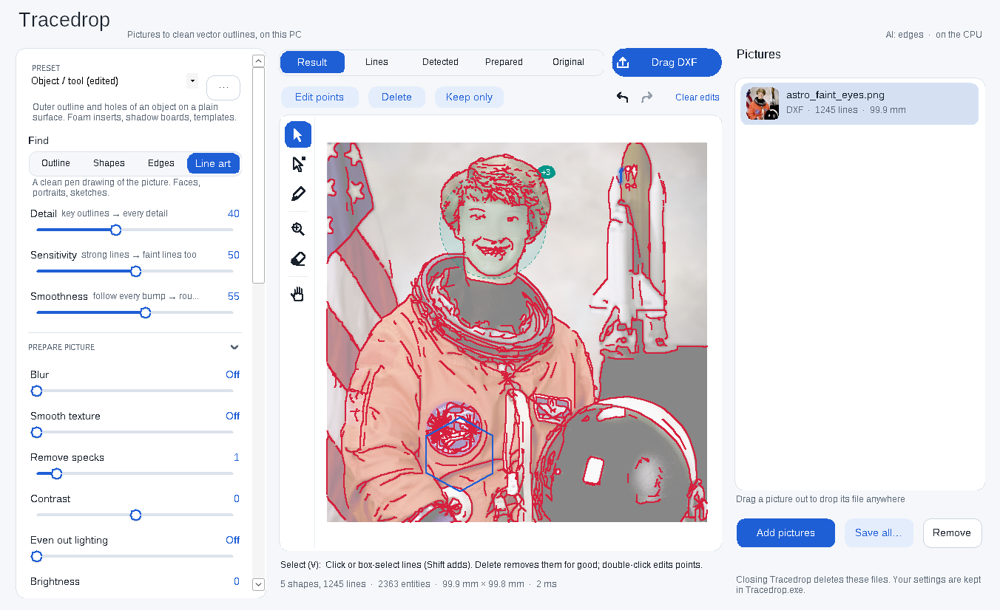

# Tracedrop

Turn any picture into clean vector outlines (DXF, SVG, PDF) on your own PC, with a live preview. Drop in
photos (PNG, JPEG, HEIC, WebP, TIFF and more), tune a few sliders, then drag the finished file
straight out of the window into SolidWorks, Fusion, Explorer or anywhere else. One portable `Tracedrop.exe`,
no install, nothing uploaded, and your settings and presets travel inside the exe.



## Use

1. Double-click `Tracedrop.exe` (see [Get the exe](#get-the-exe)).
2. Drop pictures on the window, click **Add pictures**, paste with **Ctrl+V**, or drop pictures on the exe icon.
   Several at once is fine: each one is traced in the background.
3. Pick a **preset**, then fine-tune. The preview updates as you drag a slider.
4. Drag the blue **Drag DXF** chip (or a row in the list) to wherever you want the file. **Save…** copies the
   files to a folder instead.

### Fix it by hand, right there

The AI does its best; where it misses, you finish the drawing in Tracedrop instead of redrawing it in CAD. The
canvas works like a vector editor (tools on the left, their options above the picture), and the AI keeps
tracing live around what you change:

| Tool | Key | What it does |
| --- | --- | --- |
| Select | V | Click a line to select it (Shift adds), or drag a box. **Delete** removes it for good, even when you change the settings and it re-traces. **Keep only** keeps the selection and drops the rest. Drag your own lines to move them. |
| Edit points | A | Click any line to edit its points. An AI line becomes yours (blue) the moment you do. Drag points and Bezier handles, click the line to add a point, Alt-click a point to switch corner ↔ curve, Delete removes a point. |
| Pen | P | Draw your own line: click for corners, drag for curves, Shift for 45°. Click the first point to close it; Enter or right-click finishes, Esc cancels. |
| Find lines here | F | Lines missing (eyes, glasses, a faint edge)? Mark the spot with a circle, rectangle or brush. The AI looks again there: it crops and enlarges that area, spreads its tones and traces it at a closer scale, and its lines replace what was inside. Scroll over the area for more (+) or fewer (−) lines. |
| Erase lines here | E | Mark where there should be no lines (background clutter, texture). In Outline and Shapes modes it cuts the shapes. |
| Hand | H | Pan. Space with any tool does the same; scroll zooms, Ctrl+0 or double-click fits. |

Later marks win where they overlap, as in a paint program: erase a messy patch, then mark Find inside it to get
just the line you want. Right-click a Find or Erase area to remove it; **Ctrl+Z** / **Ctrl+Y** undo and redo
every edit, per picture; **Clear edits** starts over. Your own lines are exported exactly as drawn (lines stay
lines, curves become splines) on the same layers as the traced ones. Every picture keeps its own edits when you
change settings or apply them to all.

Traced files live in a temporary folder until you drag or save them. Closing Tracedrop deletes that folder
(a hidden helper does it even if the app is killed) and stores your settings inside `Tracedrop.exe`.

## Presets

| Preset | For | What it does |
|---|---|---|
| **Object / tool** | Tools, objects on a plain surface (foam inserts, shadow boards, templates) | Outer outline plus holes, background removed |
| **Part to copy** | Flat parts to reverse-engineer in CAD | Sharp corners, true circles, accurate edges |
| **Logo / artwork** | Graphics, prints, stencils, screenshots | Crisp filled shapes; optionally one layer per colour |
| **Sketch / drawing** | Pen or pencil drawings | Single centerlines |
| **Face line drawing** | Portraits for engraving | A clean pen drawing of the face |
| **Leaf / nature** | Leaves, branches, flowers, animals | Organic outlines as smooth splines |
| **All edges** | Anything | Every visible edge; Detail down gives just the main ones |

Save your own from the **···** menu next to the preset. They are stored in the exe and go with it to the next PC.

## Settings

The main sliders cover almost everything:

- **Find**: *Outline* (the subject's silhouette and holes), *Shapes* (areas by brightness or colour), *Edges*
  (every edge, by the TEED network), *Line art* (a pen drawing).
- **Detail**: from key outlines only to every detail. It sets the smallest feature kept (specks, short
  lines, tiny holes) and, for edges, how much faint detail is included.
- **Tightness / Cut level / Sensitivity**: where the line is drawn. For outlines that is how confident the
  subject mask must be; for shapes it is the brightness cut (or *Automatic*); for edges and line art it is
  how faint a line may be.
- **Smoothness**: from following every bump to round, simple curves. It sets both the smoothing and how far
  the vector may deviate from the traced edge, so higher also means fewer entities.

**Prepare picture** filters run before detection, so noise and texture never get traced:

| Filter | Use it for |
|---|---|
| Blur | Grainy photos, soft overall simplification |
| Smooth texture | Wood grain, fabric, skin, concrete: flattens texture but keeps outlines sharp (bilateral filter) |
| Remove specks | Dust, scanner noise, salt-and-pepper (median filter) |
| Contrast, Brightness | Faint subjects |
| Even out lighting | Shadows and uneven light across the page (CLAHE) |
| Invert | Light drawings on a dark background |
| Isolate subject | AI background removal before Edges, Shapes or Line art |

**Clean up**: *Close gaps* joins broken outlines, *Fill holes* keeps outer outlines only, *Largest shape only*.

**Output**:

- *Curves*: **Lines & arcs** (default) writes true arcs, which are light and easy to dimension and constrain
  in CAD. **Splines** writes smooth B-splines (organic shapes). **Polylines** writes straight segments only.
- *Corners*: how sharp a turn has to be to stay a corner.
- *Snap round shapes to circles*: round holes and discs become exact CIRCLE entities.
- *Lines as*: Centerline (one line per stroke, for engraving or toolpaths) or Outline (closed, extrudable).
- *Size*: the traced shape's longest side, in mm or inches. *Offset* grows (+) or shrinks (−) every shape,
  for clearance in foam inserts or for kerf.
- *Resolution*: the size the picture is traced at (1024 to 3600 px). Higher is more precise and slower.
- *Files*: DXF, SVG and/or PDF. Dragging gives you every format that's switched on.
- *Use graphics card for AI*: on by default. Tracedrop uses the GPU with the most video memory (the discrete
  GPU on laptops that have two). If the GPU fails, for example a driver reset or running out of video memory,
  Tracedrop switches to the CPU, finishes the picture there, and remembers the choice.

## Files for CAD

The DXF is AutoCAD 2000 format, in millimetres or inches (`$INSUNITS` set), with the drawing's bottom-left
corner at 0,0:

- Every outline is a single closed LWPOLYLINE (lines and arcs as bulges), so it selects as one profile and
  extrudes directly in SolidWorks and Fusion.
- Snapped holes are CIRCLEs, and splines are clamped cubic SPLINEs.
- Layers: `OUTLINE` (outer outlines), `HOLES` (holes, in blue), `LINES` (centerlines), `COLOR_n` (colour
  layers).

SVG is sized in real units with hairline strokes (laser software and Fusion's Insert SVG read it at true
size). PDF is a true-size one-page vector.

## How it works

```
picture ──► load (any format, EXIF rotation, transparency) ──► scale to working size
        ──► prepare: specks · texture · blur · contrast · lighting · invert · isolate subject (AI)
        ──► detect:  Outline = BiRefNet subject mask (AI) or border-colour model
                     Shapes  = Otsu / manual threshold, or k-means colour layers
                     Edges   = TEED edge network (AI) or Canny, two-level threshold
                     Line art = Informative Drawings (AI), else TEED + XDoG
        ──► clean:   close gaps · drop specks and pinholes · fill holes · your Find/Erase marks (shapes)
                     · picks · largest · offset
        ──► trace:   sub-pixel contours (marching squares) or centerlines (thinning + graph walk, spur pruning,
                     corner and crossing knots merged) · your Find/Erase marks (lines) · deleted lines
        ──► fit:     corner detection → smoothing between corners → lines & arcs / Bezier splines /
                     polylines within a tolerance; round loops → circles
        ──► yours:   your own paths added exactly as drawn
        ──► export:  DXF · SVG · PDF
```

Every stage is cached with the settings it was computed from, so a slider only re-runs the stages after it.
Smoothness, Corners and Curves re-fit in about 0.1 s even for a busy picture. The AI models run once per
picture or filter change: on any DirectX 12 GPU through DirectML, otherwise on the CPU (TEED takes about 1.5 s
for a 1600 px picture on a 4-core CPU).

Measured on test pictures (see `Tracedrop.Core.Tests`): a photographed plate with three holes and a slot traces
to one outline, three exact circles (radii within 1 px) and a slot. That is 18 entities, and a 2 mm offset
lands within ±0.6 mm. Portraits come out as continuous pen strokes rather than fragments.

## Get the exe

Every push builds `Tracedrop.exe` on GitHub Actions (**Actions → Build → Tracedrop** artifact), and
`v*` tags attach it to a release. To build it yourself on Windows with the [.NET 8 SDK](https://dotnet.microsoft.com/download):

```powershell
powershell -ExecutionPolicy Bypass -File build.ps1
```

That fetches the AI models, runs the tests and writes `dist\Tracedrop.exe`: one self-contained file,
about 120 MB, or roughly 350 MB with the downloaded background-removal and line-drawing models. It also builds
from Linux or macOS with `dotnet publish TracedropApp -c Release -o dist`.

Requirements: Windows 10 or 11, x64. A DirectX 12 GPU makes the AI steps fast but isn't required, and the
Visual C++ runtime is built in. The window stays responsive while models run: AI and image work run in the
background and leave CPU cores free for the window.

## Project layout

| Folder | What it is |
|---|---|
| `Tracedrop.Core/` | The engine: loading, filters, detection, clean-up, tracing, fitting, DXF/SVG/PDF export, presets, portable settings. Plain .NET 8, cross-platform. |
| `Tracedrop.Models/` | Carries the ONNX models inside the exe. |
| `TracedropApp/` | The Windows window (WinForms), styled after Taildrop. |
| `Tracedrop.Core.Tests/` | Tests on synthetic pictures with known geometry. |
| `tools/TraceCli/` | `tracedrop-cli`: the same engine from the command line (batch jobs, scripting). |
| `tools/models/` | Model manifest, download script, and the TEED export script. |

```bash
dotnet test Tracedrop.Core.Tests
dotnet run --project tools/TraceCli -- photo.heic --preset "Part to copy" --formats dxf,svg --render
```

## Background

Compared with the tools already out there:

- **Scan2CAD** (desktop, paid) and **Inkscape Trace Bitmap** (Potrace) need clean black-and-white input.
- **Vectorizer.AI** traces very well but is cloud-only and paid.
- Photo-to-tool-outline web apps (Tooltrace, TracetoForge) use plain OpenCV edges.

Tracedrop combines small open models with classic vision, all running locally: TEED for edges, BiRefNet for
subjects, Informative Drawings for portraits. Its own MIT tracer means no GPL code. See
[THIRD_PARTY_NOTICES.md](THIRD_PARTY_NOTICES.md).

## Licence

MIT. See [LICENSE](LICENSE).
